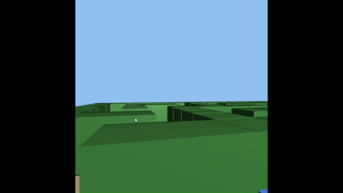

# Práctica 5 · Informática Gráfica: Iluminación


· Autor: [Alejandro José Martel Torres](https://github.com/AlejandroMartel1)  - Acceso directo al proyecto: [CodeSandbox](https://codesandbox.io/p/sandbox/webgl-prac5-inicial-forked-7n2j27)

El desarrollo de esta quinta práctica consiste en una extensión de la entrega anterior, a la cual se le ha incorporado iluminación de Phong utilizando WebGL2 y gl-matrix.

Partiendo del laberinto 3D implementado en la práctica 4 se ha aplicado el modelo de sombreado descrito en el guion de la práctica 5. Esto corresponde  a una de las ampliaciones propuestas: incorporar iluminación a la escena de la práctica anterior calculando y añadiendo las normales de los objetos.

<br>
<div align="center">

      <br>
      <em>Figura 1. Proyecciones en los cubos del laberinto.</em>
</div>

## Movimientos del jugador 


En esta quinta práctica no se ha modificado el movimiento del jugador. Por tanto, 
a modo recordatorio en la siguiente tabla se encuentran las teclas que permiten moverse por el espacio:


<div align="center">

| Tecla | Acción |
|---|---|
| ↑ / W | Avanzar |
| ↓ / S | Retroceder |
| ← / → | Girar la vista |
| A / D | Desplazamiento lateral |
| Espacio | Saltar |
</div>


## Iluminación implementada

### 1. Sombreado de Phong

Se usan los shaders del apartado *"Sombreado de Phong en el fragment shader"* del guion:

- El **vertex shader** solo calcula tres vectores por vértice y los pasa como *varyings*:
  - `vNormal`: la normal transformada con `uModelMatrix` (con coordenada homogénea 0, para que le afecten rotaciones y escalados pero no traslaciones).
  - `vEyeVector`: el vector del vértice al observador (`-vertex.xyz`).
  - `vLightDirection`: el vector del vértice a la luz.
- El fragment shader recibe esos vectores interpolados para cada píxel y calcula la ecuación de iluminación:

```
color = Iambiente + Idifusa + Iespecular
```

| Componente | Cálculo |
|---|---|
| Difusa | `max(N · L, 0) · materialDifuso` |
| Especular | `max(R · V, 0)^shininess · materialEspecular`, con `R = 2N(N·L) − L` |
| Ambiente | `0.3 · materialDifuso` |

El resultado se limita a 1 con `min(fragColor, vec4(1,1,1,1))`.

Al calcularse por píxel y no por vértice (Gouraud), las caras grandes del laberinto (paredes de 2 × 2.5 y un suelo de 90 × 90) se iluminan de forma suave y el brillo especular se ve correctamente aunque caiga en mitad de una cara.

### 2. Normales y su buffer

Igual que en la esfera del guion:

- Atributo `in vec3 aVertexNormals` en el vertex shader.
- Variable `normalsLoc` con `gl.getAttribLocation` y buffer `normal_buffer` creado en el `init`.
- `gl.vertexAttribPointer` y `gl.enableVertexAttribArray` al final del `init`.
- En cada función de dibujo se carga primero el buffer de vértices y después el de normales:

```js
gl.bindBuffer(gl.ARRAY_BUFFER, vertex_buffer);
gl.bufferData(gl.ARRAY_BUFFER, arrayV, gl.STATIC_DRAW);
gl.bindBuffer(gl.ARRAY_BUFFER, normal_buffer);
gl.bufferData(gl.ARRAY_BUFFER, normals, gl.STATIC_DRAW);
```

### 3. Cubo iluminado sin índices

Como explica el guion en *"Añadiendo iluminación a una caja"*, en una esfera cada vértice tiene una única normal, pero en un cubo cada vértice pertenece a tres caras con normales distintas. Con el vector de índices de la práctica 4 (8 vértices y 36 índices) cada vértice solo podría tener una normal.

Por eso `renderCube` ahora pinta sin índices:

- Un array de 36 vértices (6 por cara, 2 triángulos), con los mismos triángulos que el antiguo vector de caras.
- Un array de 36 normales, repitiendo la normal de cada cara en sus 6 vértices.
- Se dibuja con `gl.drawArrays(gl.TRIANGLES, 0, 36)`.


<div align="center">

| Cara | Normal |
|---|---|
| Trasera | (0, 0, −1) |
| Delantera | (0, 0, 1) |
| Superior | (0, 1, 0) |
| Inferior | (0, −1, 0) |
| Derecha | (1, 0, 0) |
| Izquierda | (−1, 0, 0) |

</div>


Las aristas negras de la práctica 4 desaparecen, tal y como hace el guion de la quinta práctica al empezar: ahora la propia iluminación es la que distingue unas caras de otras.


### 4. Material de cada objeto

En el guion el material difuso era un verde fijo en el shader. Aquí se toma del uniform `uColor`, de modo que cada objeto se ilumina con su propio color, igual que en el apartado *"Añadiendo un color dialog a la gui"*, donde el color del material se pasa con un uniform:

<div align="center">

| Objeto | Color difuso |
|---|---|
| Paredes | Verde oscuro `[0.2, 0.4, 0.2]` |
| Cubos | Azul `[0.3, 0.5, 1]` |
| Suelo | Arena `[0.75, 0.68, 0.5]` |
| Rejilla | Negro `[0, 0, 0]` |

</div>


### 5. Posición de la luz: fija, no anclada

En el laberinto, en cambio, cada cubo tiene su propia modelMatrix (con su traslación y escala), por lo que la versión anclada daría a cada pared su propia luz y la iluminación no sería coherente. Por tanto, se ha optado por aplicar la luz fija de entre las dos opciones que mostraba el guion:


```glsl
vec4 light = vec4(10,10,10,1);                 // luz fija
vec4 light = uModelMatrix * vec4(10,10,10,1);  // luz anclada al objeto
```

**Nota:** en el desarrollo de esta práctica hemos aplicado los fundamentos adquiridos en la práctica desarrollada en clase. La IA se ha utilizado para hacer consultas de funcionamiento para algunas funciones y confirmar una correcta implementación.
