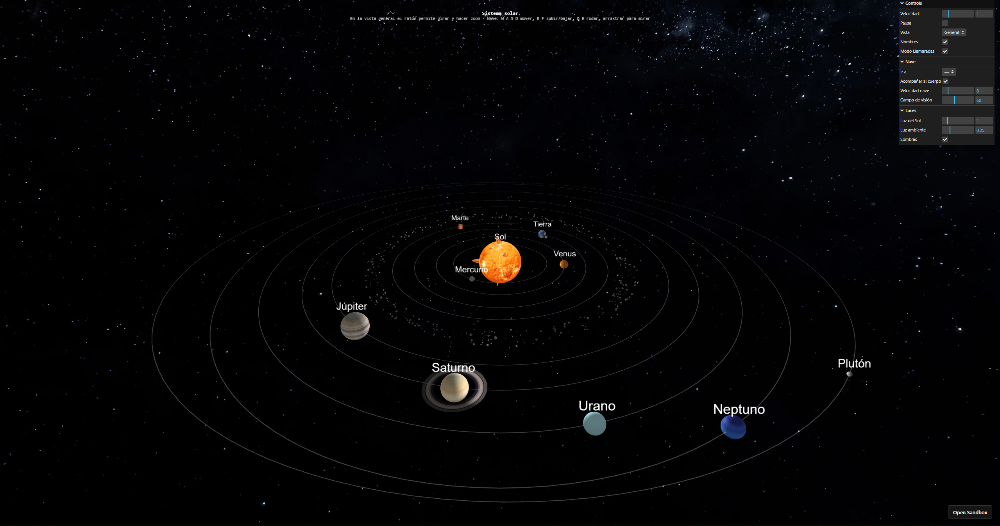
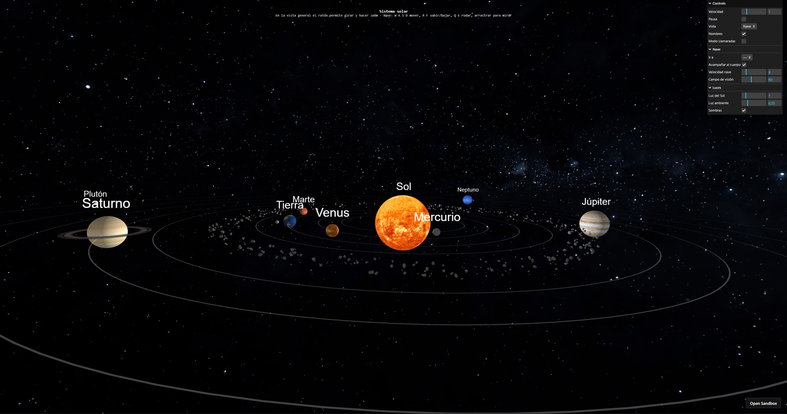
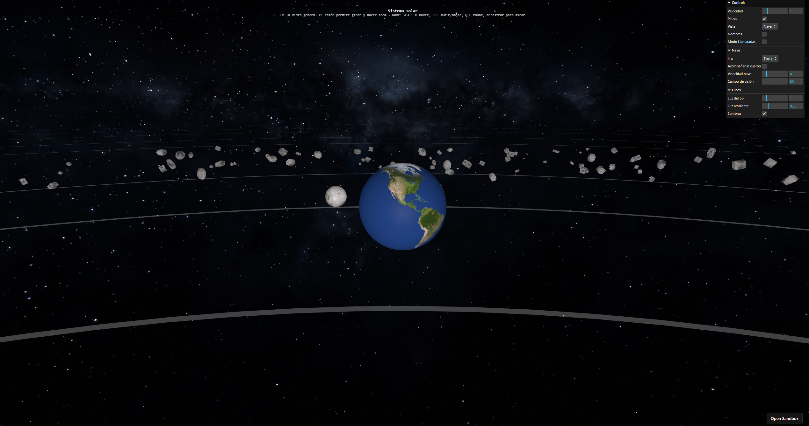
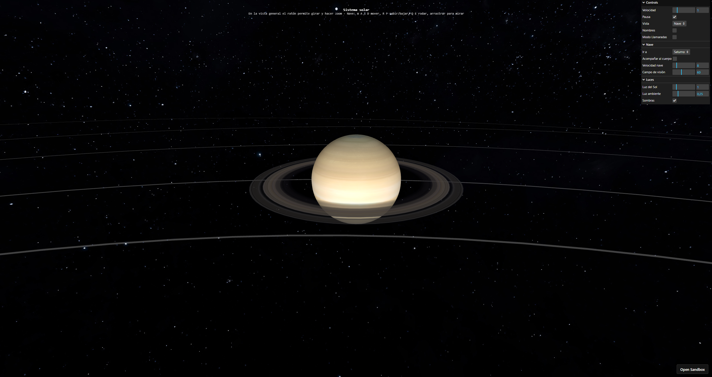
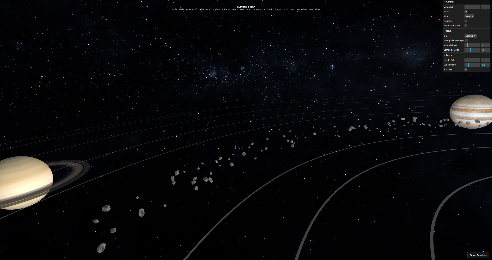
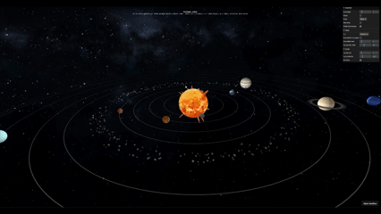
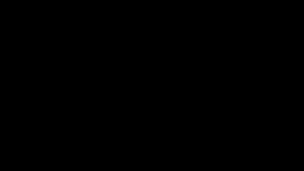
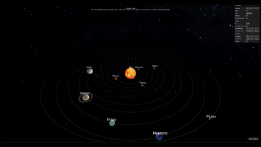

· Autor: [Alejandro José Martel Torres](https://github.com/AlejandroMartel1)     - Acceso directo al proyecto: [CodeSandbox](https://codesandbox.io/p/sandbox/sistemasolar-forked-lw237m) 

# Sistema solar 3D

En esta práctica construimos un sistema planetario con *three.js*: el Sol, ocho planetas, Plutón, la Luna, los anillos de Saturno y un cinturón de asteroides. La escena se puede recorrer de dos formas, con una vista general que se orbita con el ratón y con una vista subjetiva desde una nave que se maneja con el teclado, como se ve en las siguientes imágenes:

<table align="center">
  <tr>
    <td align="center">
      
      <br>
      <em>Figura 1. Vista general del sistema solar.</em>
    </td>
    <td align="center">
      
      <br>
      <em>Figura 2. Vista subjetiva desde la nave, junto a un planeta.</em>
    </td>
  </tr>
</table>


## Decisiones de desarrollo

### Texturas y materiales

Todos los planetas usan `MeshPhongMaterial`, que admite la respuesta a las luces de la escena. El Sol, el cielo y las órbitas usan `MeshBasicMaterial`, porque no les afectan las luces. Las texturas de color se marcan como sRGB (`colorSpace = THREE.SRGBColorSpace`) a través del parámetro `esColor` (activo por defecto) en la función `cargarTextura`, que además incorpora un aviso en consola en caso de que falle la carga de algún archivo.

<br>

<table align="center">
  <tr>
    <td align="center">
      
      <br>
      <em>Figura 3. La Tierra junto a la Luna y su línea orbital.</em>
    </td>
    <td align="center">
      
      <br>
      <em>Figura 4. Saturno, sus anillos con transparencia y su sombra sobre ellos.</em>
    </td>
  </tr>
</table>
<br>


**Órbitas.** La trayectoria de cada planeta se dibuja en el plano XZ un anillo muy fino (`RingGeometry` entre `dist − 0,03` y `dist + 0,03`) con material básico blanco semitransparente (`opacity = 0,25`). Para adaptarse a la trayectoria elíptica de cada planeta, la malla de la órbita se escala en su eje local Y según el factor `f2` (`orbita.scale.set(1, f2, 1)`).

**Cielo.** Es una esfera enorme (radio 1500) con la textura de la Vía Láctea (`stars_milkyway.jpg`), vista desde dentro (`side: THREE.BackSide`). Las dos cámaras tienen `far = 3000` para que se vea completa.

### Iluminación y sombras

La escena usa tres tipos de luz:

<div align="center">

| Luz | Parámetros | Función |
|---|---|---|
| `AmbientLight` | blanca, intensidad 0,25 | Evita que las caras sin sol queden completamente negras |
| `PointLight` | en el origen, sin atenuación | El Sol: ilumina en todas direcciones |
| `SpotLight` | intensidad 2, distancia 80, ángulo π/6, penumbra 0,5 | Faro de la nave: cuelga de la cámara de la nave y apunta hacia delante |

</div>

La luz puntual se coloca en el centro, dentro de la esfera del Sol, con distancia 0 y `decay = 0`, para que no pierda intensidad con la distancia y llegue igual a Plutón que a Mercurio. Las sombras se activan en el renderizador (`shadowMap.enabled`, con `PCFSoftShadowMap`) y en la luz del Sol (`castShadow`), y se aplican de esta forma:

- Los **planetas y la Luna** proyectan y reciben sombra.
- Los **anillos de Saturno** solo reciben: así se ve la sombra del planeta sobre ellos.
- Las **rocas del cinturón** no proyectan ni reciben sombra.

Tal y como se indica el guion, las sombras de una luz puntual suponen un coste importante, porque la escena se calcula desde la luz en varias direcciones. Por eso las 400 rocas no proyectan sombra, y todas las sombras se pueden desactivar desde el panel. Además, hemos ajustado el mapa de sombras (`mapSize = 2048`, `camera.far = 100`) y un pequeño `bias = −0,0005` para evitar las rayas que aparecen en las superficies curvas.

**Nota:** el ajuste del `bias` y del tamaño del mapa de sombras se consultó con la IA, ya que sin él aparecían rayas en la superficie de los planetas.

### Cinturón de asteroides

El cinturón está formado por 400 rocas pequeñas entre Marte y Júpiter. Para que no parezcan todas iguales:

- Se mezclan dos geometrías, un cubo (`BoxGeometry`) y una esfera de muy pocos segmentos (`SphereGeometry(1, 4, 4)`).
- Todas comparten un único material, con la textura de la Luna y `flatShading`, para que las caras se vean angulosas como en una roca.
- Cada roca tiene una rotación aleatoria y una escala distinta en cada eje, de modo que no hay dos iguales.

Cada roca se coloca en un punto aleatorio de la corona entre `rMin = 13,8` y `rMax = 15,8`, con una pequeña dispersión en altura:

```
r = rMin + aleatorio · (rMax − rMin)
x = cos(θ) · r
z = sin(θ) · r
y = (aleatorio − 0,5) · 0,6
```

Todas las rocas cuelgan de un mismo `Object3D` que gira lentamente alrededor del Sol, lo que da la sensación de que el cinturón orbita.

### Llamaradas solares

Para dar vida al Sol se han añadido 15 llamaradas. Son esferas pequeñas con la textura del propio Sol y algo de transparencia (`opacity = 0,85`), repartidas sobre su superficie con coordenadas esféricas:

```
x = cos(a) · sin(b) · R
y = cos(b) · R
z = sin(a) · sin(b) · R
```

siendo `R` el radio del Sol y `a`, `b` dos ángulos aleatorios. Con `lookAt(0, 0, 0)` se orienta el eje Z de cada llamarada hacia el centro, de manera que al estirarla en Z crece en dirección radial, hacia fuera de la superficie. Cada llamarada cuelga del Sol, por lo que gira con él.

En cada frame se deforman con ondas trigonométricas, usando una fase aleatoria `φ` distinta para cada una, de modo que no se muevan de forma sincronizada:

```
escZ = 1,5 + sin(4t + φ) · 1,2 + cos(7t + 2φ) · 0,5
escX = 0,5 + sin(3t + φ) · 0,2
escY = 0,5 + cos(5t + φ) · 0,3
```

Se aplica `Math.max(0,1; escZ)` para que la escala nunca llegue a cero ni se invierta la malla, y se suma un giro continuo sobre el eje Z para que se retuerzan. Se pueden activar y desactivar con el control *Modo Llamaradas* del panel.

<table align="center">
  <tr>
    <td align="center">
      
      <br>
      <em>Figura 5. Cinturón de asteroides entre Marte y Júpiter.</em>
    </td>
    <td align="center">
      
      <br>
      <em> Llamaradas solares animadas.</em>
    </td>
  </tr>
</table>

### Vistas y control de la nave

Hay dos cámaras en la escena y se alterna entre ellas con el control *Vista* del panel, que cambia la cámara que usa el renderizador:

- **General:** `OrbitControls` para girar alrededor del sistema y acercarse o alejarse con el ratón.
- **Nave:** una segunda cámara de perspectiva, con `FlyControls` para moverla libremente, que ofrece la vista subjetiva de una nave que recorre el sistema.

En cada frame solo se actualiza el control de la vista activa. Las teclas de la nave son:

<div align="center">

| Tecla | Acción |
|---|---|
| `W` / `S` | Avanzar / retroceder |
| `A` / `D` | Desplazamiento lateral |
| `R` / `F` | Subir / bajar |
| `Q` / `E` | Rodar sobre el eje de la vista |
| Arrastrar con el ratón | Mirar a otro lado |

</div>

La nave dispone además de un **faro** (`SpotLight`) que ilumina lo que tiene delante, útil para ver las caras de los planetas que no reciben la luz del Sol.


<table align="center">
  <tr>
    <td align="center">
      
      <br>
      <em> Se observa el reflejo de los faros de la nave sobre la superficie de Marte al acercarse.</em>
    </td>

</table>


### Interfaz y etiquetas

La interfaz es un panel con `lil-gui`, y en la parte superior de la pantalla se muestra siempre un encabezado con una línea de ayuda que muestra los controles de ratón y teclado, de modo que no hace falta documentación externa para manejarla.

<div align="center">

| Control | Función |
|---|---|
| Velocidad | Acelera o frena toda la animación (0 a 5) |
| Pausa | Detiene la simulación |
| Vista | Alterna entre la vista general y la de la nave |
| Nombres | Muestra u oculta los carteles con el nombre de cada cuerpo |
| Modo Llamaradas | Activa o desactiva las llamaradas del Sol |
| **Nave** › Ir a | Coloca la nave junto a un cuerpo |
| **Nave** › Acompañar al cuerpo | La nave sigue el movimiento del cuerpo elegido |
| **Nave** › Velocidad nave | Velocidad de desplazamiento de la nave (1 a 40) |
| **Nave** › Campo de visión | Ángulo de visión de la cámara de la nave (20 a 120) |
| **Luces** › Luz del Sol | Intensidad de la luz puntual (0 a 6) |
| **Luces** › Luz ambiente | Intensidad de la luz ambiente (0 a 1) |
| **Luces** › Sombras | Activa o desactiva las sombras |

</div>

Los carteles con el nombre son *sprites* (`THREE.Sprite`) a los que se asigna una textura creada dinámicamente a partir de un `canvas` 2D con el texto del cuerpo, y cuelgan del nodo de cada astro para acompañarlo en su movimiento.


## Vídeo y animación representativa

Vídeo con la ejecución de la tarea:  [youtube](https://www.youtube.com/watch?v=uQ5o9G8xiyU) 

<p align="center">
  
  <br>
  <em> Animación gráfica del sistema solar, con el cambio entre la vista general y la de la nave. </em>
</p>


## Fuentes de referencia o consulta

- Guion de la asignatura 

- Documentación de *three.js*:
  - [PointLight](https://threejs.org/docs/#api/en/lights/PointLight)
  - [SpotLight](https://threejs.org/docs/#api/en/lights/SpotLight)
  - [Sombras: WebGLRenderer.shadowMap](https://threejs.org/docs/#api/en/renderers/WebGLRenderer.shadowMap)
  - [MeshPhongMaterial](https://threejs.org/docs/#api/en/materials/MeshPhongMaterial)
  - [FlyControls](https://threejs.org/docs/#examples/en/controls/FlyControls)
- Texturas:
  - Superficies de planetas, Luna, Sol, anillos de Saturno y cielo estrellado: [Solar System Scope](https://www.solarsystemscope.com/textures/) 

