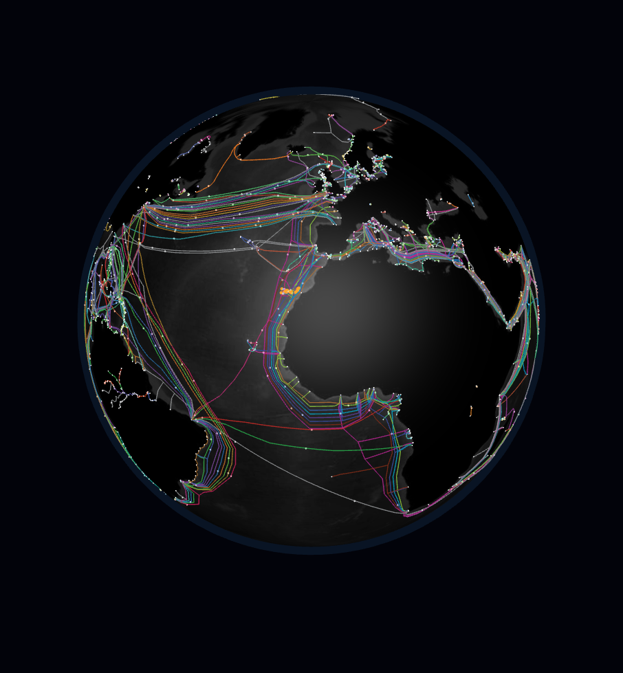
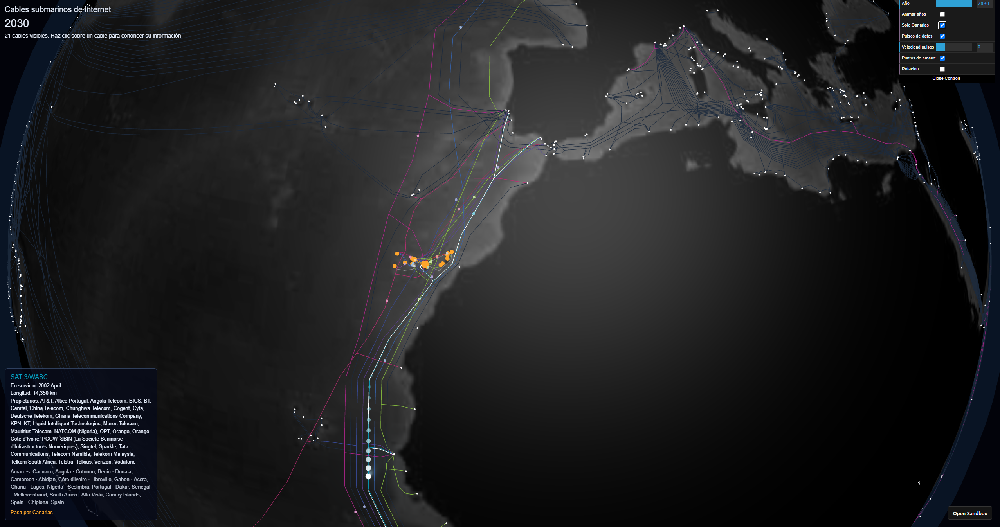
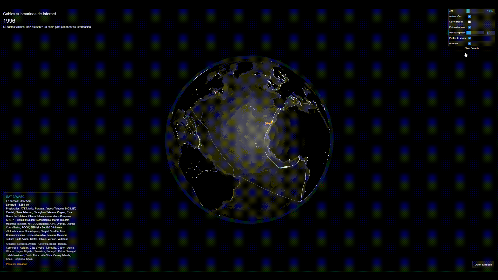

· Autor: [Alejandro José Martel Torres](https://github.com/AlejandroMartel1)     - Acceso directo al proyecto: [CodeSandbox](https://codesandbox.io/p/sandbox/eager-knuth-t7qp3w)

# Cables submarinos de internet

En esta práctica se muestra la red mundial de cables submarinos de telecomunicaciones, por los que viaja la mayor parte del tráfico de internet entre continentes. Sobre la Tierra se dibuja el trazado de cada cable y sus puntos de amarre en tierra, con pulsos de luz que recorren los cables simulando el paso de los datos. Además, se incluye una evolución temporal para ver cómo ha crecido la red año a año, y un resaltado de las Islas Canarias.

<table align="center">
  <tr>
    <td align="center">
      
       
      <em>Figura 1. Vista general de la red de cables submarinos.</em>
    </td>
    <td align="center">
      
       
      <em>Figura 2. Cables que pasan por Canarias y ficha de un cable seleccionado.</em>
    </td>
  </tr>
</table>

## Datos utilizados

Los datos proceden de [Submarine Cable Map](https://www.submarinecablemap.com), de TeleGeography, que publica de forma abierta el trazado de los cables y la información de cada uno. Como en los ejemplos del guion, los datos no se descargan durante la ejecución, sino que se obtienen previamente y se guardan en la carpeta `src/`.

Para ello se ha preparado el script de Python con ayuda de Claude `descarga_cables.py`, que hace las mismas peticiones que la web realiza a su API  y genera tres archivos:

| Archivo | Contenido | Formato |
|---|---|---|
| `cable-geo.json` | Trazado de cada cable: id, nombre, color y coordenadas | GeoJSON (`MultiLineString`) |
| `landing-point-geo.json` | Puntos de amarre de los cables en tierra | GeoJSON (`Point`) |
| `cables_info.json` | Año de puesta en servicio, longitud, propietarios y amarres | JSON `{ id: datos }` |

Los dos primeros se guardan tal cual. El tercero se construye recorriendo los `id` de `cable-geo.json` y pidiendo la ficha individual de cada cable (`/api/v3/cable/<id>.json`), de la que solo se conservan los campos que usa la visualización (`rfs`, `rfs_year`, `length`, `owners`, `is_planned` y los nombres de los amarres). El `id` de cada cable es la clave que une los archivos: en el script se usa `info[id]` para asociar a cada trazado su año, longitud y propietarios.

## Decisiones de desarrollo

### Globo terráqueo

La Tierra es una esfera de radio 1 (`SphereGeometry(R, 96, 96)`) con `MeshPhongMaterial` y la textura `earth-dark.jpg`, una versión oscura del planeta para que los cables y los pulsos destaquen sobre ella. La función `CargaTextura`  busca la textura en `src/`.

### De latitud y longitud a la esfera

En la práctica de clase, la función `Map2Range` situaba las coordenadas sobre un plano. Aquí los datos se colocan sobre una esfera, por lo que la función `latLon2Vec` convierte cada pareja de latitud y longitud en coordenadas esféricas, de forma que coincidan con la textura de `SphereGeometry`:

<table><tr><td>
<pre>
φ = 90 − latitud        
θ = longitud + 180
x = −r · sen(φ) · cos(θ)
y =  r · cos(φ)
z =  r · sen(φ) · sen(θ)
</pre>
</td></tr></table>

### Curvatura de los cables

Los puntos de algunos cables están muy separados, y una recta entre dos puntos lejanos de la superficie atravesaría la Tierra por dentro. Para evitarlo, la función `SigueCurvatura` añade puntos intermedios: calcula el ángulo entre cada par de puntos consecutivos (`angleTo`) y los divide en tantos tramos como grados de arco haya. Cada punto intermedio se interpola entre los dos extremos y se normaliza, lo que lo devuelve a la superficie de la esfera.

### Una única geometría para todos los cables

En lugar de crear una línea por cable, todos se agrupan en un único `LineSegments`, con una `BufferGeometry` que guarda las posiciones y un color por vértice (`vertexColors: true`), tomado del color que cada cable tiene en los datos. Con más de 700 cables, esto supone una sola llamada de dibujo en vez de cientos. Antes de construir la geometría, los cables se ordenan por año de puesta en servicio. Gracias a ello, el filtro de la línea temporal no necesita recalcular nada: basta con dibujar los primeros vértices de la geometría con `setDrawRange`.

### Línea temporal y filtros

El control *Año* muestra solo los cables que ya estaban en servicio ese año. Con *Animar años*, el año avanza solo, a razón de tres años por segundo, y se puede ver cómo se va cableando el planeta desde los años 90. Los cables sin año conocido se muestran en todo momento. Por otra parte, el control *solo Canarias* resalta los cables que tienen algún punto dentro del recuadro de las islas, y apaga el resto con un color azul oscuro en lugar de ocultarlos, para que no se pierda el contexto. El mismo recuadro se usa para resaltar los amarres de Canarias con esferas naranjas:

### Pulsos de datos

Por cada cable circulan puntos de luz, en mayor número cuanto más largo es el cable (cuatro por unidad de longitud). Todos forman un único objeto `Points` con mezcla aditiva (`AdditiveBlending`) y una textura circular con degradado creada con un `canvas`, de forma que parecen luz en lugar de puntos sólidos. Además, para que avancen a velocidad constante, la clase `Polilinea` guarda la longitud acumulada de cada tramo y su método `punto(u)` devuelve la posición a una fracción `u` de su recorrido, buscando el tramo correspondiente con una búsqueda binaria. 

### Haz de luz

El cable seleccionado es recorrido por un haz de luz que simula un pulso fotónico. Está formado por 14 esferas: la cabeza es blanca y el resto forman una estela que toma el color del cable y se va haciendo más pequeña y transparente. Junto a la cabeza viaja  `PointLight` que ilumina la superficie del globo a su paso. Si el cable tiene varios tramos, el haz recorre el más largo. Asimismo, también es destacable comentar que la escena se compone de dos luces:

| Luz | Parámetros | Función |
|---|---|---|
| `AmbientLight` | blanca, intensidad 0,6 | Evita que la cara del globo sin luz quede negra |
| `DirectionalLight` | blanca, intensidad 1,2, unida a la cámara | Ilumina siempre la cara del globo que se está mirando |

### Interfaz

La cámara se controla con `OrbitControls`, con amortiguación (`enableDamping`), el desplazamiento lateral desactivado y la velocidad del zoom reducida (`zoomSpeed = 0,3`), para que acercarse al globo sea más suave. La distancia está limitada entre 1,2 y 10, y la vista inicial se sitúa sobre Canarias.

| Control | Función |
|---|---|
| Año | Muestra los cables en servicio hasta ese año |
| Animar años | Avanza el año automáticamente |
| Solo Canarias | Resalta los cables que pasan por las islas |
| Pulsos de datos | Muestra u oculta los pulsos |
| Velocidad pulsos | Velocidad de los pulsos (0,01 a 0,5) |
| Puntos de amarre | Muestra u oculta los amarres |
| Rotación automática | Hace girar el globo |

## Vídeo y animación representativa

La demostración del proyecto se puede encontrar en línea a través de [youtube](https://youtu.be/Mb9K3X4yRD0).

  
   
  <em> Crecimiento de la red de cables con la línea temporal y haz de luz sobre un cable seleccionado. </em>

## Fuentes de referencia o consulta

- Guion de la asignatura

- Documentación de *three.js*:
  - [BufferGeometry](https://threejs.org/docs/#api/en/core/BufferGeometry)
  - [LineSegments](https://threejs.org/docs/#api/en/objects/LineSegments)
  - [Points](https://threejs.org/docs/#api/en/objects/Points) y [PointsMaterial](https://threejs.org/docs/#api/en/materials/PointsMaterial)
  - [Raycaster](https://threejs.org/docs/#api/en/core/Raycaster)
  - [PointLight](https://threejs.org/docs/#api/en/lights/PointLight)
  - [OrbitControls](https://threejs.org/docs/#examples/en/controls/OrbitControls)
- Datos:
  - Trazados y fichas de los cables: [Submarine Cable Map (TeleGeography)](https://www.submarinecablemap.com)
- Texturas:
  - Tierra de noche: [three-globe](https://github.com/vasturiano/three-globe) (`earth-dark.jpg`)

