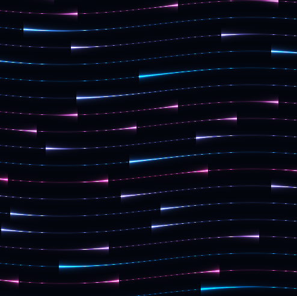
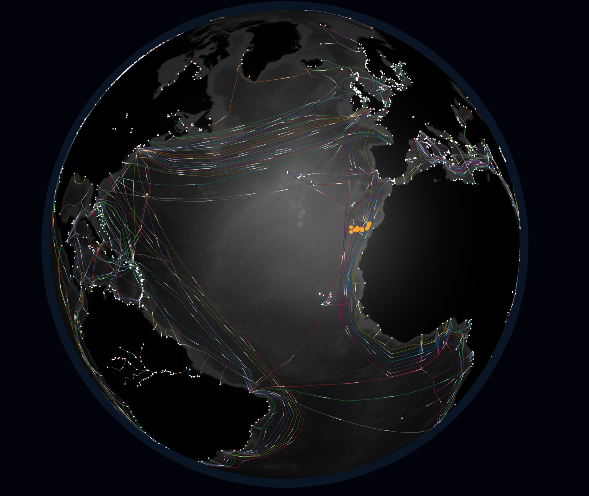
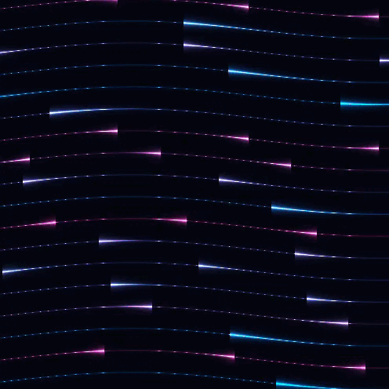
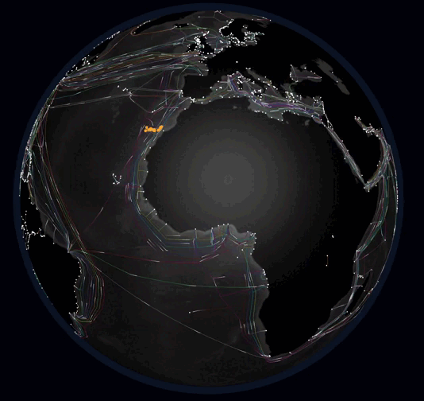

· Autor: [Alejandro José Martel Torres](https://github.com/AlejandroMartel1)       · Acceso directo al proyecto de la práctica anterior actualizado con shader: [CodeSandbox](https://codesandbox.io/p/sandbox/practica-7-forked-5vtzzy) 
# Shader de fibras ópticas

En esta práctica desarrollamos un *shader* con un patrón generativo y comportamiento dinámico: un haz de fibras ópticas que ondula, por las que viajan pulsos de luz con distinta velocidad, sentido y color en cada fibra. El *shader* se puede ejecutar directamente en el [editor de The Book of Shaders](http://editor.thebookofshaders.com) y se entrega en dos versiones: una legible y comentada, y otra minificada de **416 bytes** que cumple la restricción *tiny code* de 512 bytes. Como extra, la misma técnica se ha integrado en la práctica anterior de visualización de datos, donde los pulsos de luz recorren los cables submarinos.

<table align="center">
  <tr>
    <td align="center">
      
      <br>
      <em>Figura 1. Shader de fibras ópticas en el editor de The Book of Shaders.</em>
    </td>
    <td align="center">
      
      <br>
      <em>Figura 2. La misma técnica aplicada a los cables submarinos de la práctica anterior.</em>
    </td>
  </tr>
</table>


## Inspiración

La idea parte de la práctica anterior, en la que se visualiza la red mundial de cables submarinos de internet. Esos cables son  hilos de vidrio por los que los datos viajan como pulsos de luz. Así quem se ha intentado llevar esa imagen al *shader*: muchas fibras paralelas, cada una con su propio tráfico, por las que avanzan estelas de luz con una cabeza brillante y una estela que se apaga.


<p align="center">
  
  <br>
  <em> Patrón del shader desarrollado. </em>
</p>


## Desarrollo del shader

El *shader* solo usa los *uniforms* que proporciona el editor de The Book of Shaders, `u_resolution` y `u_time`, y se construye en varios pasos, partiendo de las técnicas vistas en el guion.

### 1. Rejilla de filas: una fila por fibra

Como en los patrones del guion, las coordenadas normalizadas se escalan para dividir la pantalla en una rejilla. En este caso solo se divide en vertical, en 18 filas (`FILAS`), y cada fila es una fibra. La parte entera indica en qué fibra está el píxel y la parte fraccionaria, en qué punto de ella:

<div align="center">
<table><tr><td>
<pre>
y    = st.y · FILAS
fila = floor(y)              (índice de la fibra)
d    = | fract(y) − 0,5 |     (distancia al centro de la fibra)
</pre>
</td></tr></table>
</div>

### 2. Ondulación del haz

Para que el haz no sea rígido, antes de calcular la fila se suma a `y` una sinusoidal que depende de la posición horizontal y del tiempo. Es la misma idea que las transformaciones del guion: modificar las coordenadas antes de dibujar.

```
y = st.y · FILAS + 0,4 · sin(st.x · 5 + u_time · 0,8)
```

El resultado es que todas las fibras ondulan a la vez, como un haz de cables que se mueve.

### 3. Aleatoriedad por fibra

Para que cada fibra tenga un comportamiento propio, se aplica la función `random` del guion (basada en `fract(sin(x) · 43758,5453)`) sobre el índice de la fila. Como todos los píxeles de una misma fibra comparten índice, comparten también el valor aleatorio `r`, que decide:

<div align="center">

| Propiedad | Cálculo | Rango |
|---|---|---|
| Sentido | `r > 0,5 ? 1 : −1` | Izquierda o derecha |
| Velocidad | `0,1 + r · 0,4` | 0,1 a 0,5 |
| Número de pulsos | `1 + floor(r · 3)` | 1 a 3 |
| Color | `mix(cian, magenta, r)` | Entre azul cian y magenta |

</div>

### 4. Brillo de la fibra

Cada fibra se dibuja con un brillo inversamente proporcional a la distancia `d` al centro de la fila, lo que da un núcleo muy intenso y un halo que se desvanece:

```
fibra = 0,015 / (d + 0,001) · (1 − 2d)
```

El `0,001` evita dividir entre cero en el centro de la fibra. El factor `(1 − 2d)` se añadió tras la primera prueba: sin él, el halo no llegaba a cero en el borde de la fila (`d = 0,5`) y se cortaba de golpe, de modo que alrededor de cada pulso aparecía un **rectángulo** de brillo. Con este factor, el halo se apaga suavemente hasta desaparecer en el borde.

### 5. Pulsos de luz

Los pulsos se consiguen con un diente de sierra que se desplaza con el tiempo. La función `fract` hace que el valor crezca de 0 a 1 a lo largo de la fibra y vuelva a empezar, y al restar el tiempo, el patrón avanza:

```
p     = fract(sentido · st.x · pulsos − u_time · velocidad + r · 10)
pulso = pow(p, 12)
```

Elevar a 12 deja brillante solo el final de cada rampa, donde `p` se acerca a 1: así se obtiene una **cabeza intensa** con una **cola** que se apaga detrás, en el sentido del movimiento. El término `r · 10` desplaza el patrón en cada fibra para que los pulsos no vayan alineados.

### 6. Color final

Por último, se combina todo. La fibra se ve siempre tenue (factor `0,15`) y se ilumina con fuerza cuando pasa el pulso (factor `4`), y se suma un fondo azul muy oscuro:

```
color = colorFibra · fibra · (0,15 + 4 · pulso) + (0,01; 0,02; 0,05)
```


## Versión tiny code

Para la versión minificada se parte de la versión legible y se aplican, paso a paso y comprobando en el editor tras cada cambio, las siguientes reducciones:

<div align="center">

| Técnica | Ejemplo |
|---|---|
| Eliminar comentarios, espacios y saltos de línea | `float fila = floor(y);` → `float f=floor(y);` |
| Nombres de una letra (salvo los *uniforms*) | `st` → `s`, `fila` → `f` |
| Quitar ceros innecesarios | `0.5` → `.5`, `18.0` → `18.` |
| Sustituir el bloque `#ifdef GL_ES` por la línea de precisión | `precision mediump float;` |
| Declarar varias variables en una sola sentencia | `float y=...,f=...,r=...;` |
| Escribir en línea lo que solo se usa una vez, incluida la función `random` | `r=fract(sin(f*12.9898)*43758.5453)` |
| Operador ternario en lugar de `if` | `(r>.5?1.:-1.)` |
| Calcular el color directamente en `gl_FragColor` | Sin variables intermedias |

</div>

La única variable que se mantiene aparte es `d`, porque se usa dos veces y guardarla ocupa menos que repetir su fórmula. El resultado ocupa **416 bytes**:

```glsl
precision mediump float;uniform vec2 u_resolution;uniform float u_time;void main(){vec2 s=gl_FragCoord.xy/u_resolution;float y=s.y*18.+.4*sin(s.x*5.+u_time*.8),f=floor(y),d=abs(fract(y)-.5),r=fract(sin(f*12.9898)*43758.5453),p=pow(fract((r>.5?1.:-1.)*s.x*(1.+floor(r*3.))-u_time*(.1+r*.4)+r*10.),12.);gl_FragColor=vec4(mix(vec3(0.,.55,1.),vec3(1.,.25,.7),r)*.015/(d+.001)*(1.-2.*d)*(.15+4.*p)+vec3(.01,.02,.05),1.);}
```


## Extra: integración en la visualización de cables submarinos

En la práctica anterior, los pulsos de datos que recorrían los cables eran esferas que se movían desde JavaScript, una por pulso. Ahora los dibuja un `ShaderMaterial` aplicado a cada cable, que reutiliza la técnica de los pulsos del *shader* de fibras ópticas, adaptada a las líneas 3D del globo.

<p align="center">
  
  <br>
  <em> Pulsos de luz recorriendo el haz de fibras ópticas. </em>
</p>

### Distancia a lo largo del cable

En el *shader* del editor, el pulso avanza según `st.x`, la posición horizontal en pantalla. En el globo, el pulso debe seguir el recorrido del cable, así que al crear cada tramo se calcula la **distancia acumulada desde el inicio del cable** en cada vértice y se guarda como un atributo de la geometría:

```js
const distancias = [0];
for (let i = 1; i < pts.length; i++) {
  distancias.push(distancias[i - 1] + pts[i].distanceTo(pts[i - 1]));
}
geometry.setAttribute("distancia", new THREE.Float32BufferAttribute(distancias, 1));
```

### Shaders de vértices y de fragmentos

El *shader* de vértices coloca el vértice en pantalla y pasa la distancia al de fragmentos mediante una variable `varying`. Entre dos vértices, la GPU interpola ese valor, de modo que cada píxel de la línea conoce su distancia al inicio del cable:

```glsl
attribute float distancia;
varying float vDistancia;

void main() {
  vDistancia = distancia;
  gl_Position = projectionMatrix * modelViewMatrix * vec4(position, 1.0);
}
```

El *shader* de fragmentos aplica la misma fórmula de los pulsos, sustituyendo `st.x` por `vDistancia`:

```glsl
float p = fract(vDistancia * DENSIDAD - u_time * u_velocidad + u_desfase);
float pulso = pow(p, 12.0) * u_pulsos * u_activo;
vec3 color = u_color * 0.6 + mix(u_color, vec3(1.0), 0.6) * pulso * 2.0;
```


### Uniforms

Los *uniforms* `u_time`, `u_velocidad` y `u_pulsos` los comparten todos los cables: son el mismo objeto en todos los materiales, por lo que basta con actualizarlos una vez por frame. Cada cable tiene además los suyos:

<div align="center">

| Uniform | Función |
|---|---|
| `u_time` | Tiempo transcurrido (compartido) |
| `u_velocidad` | Velocidad de los pulsos, desde el panel (compartido) |
| `u_pulsos` | 1 si los pulsos están activados en el panel, 0 si no (compartido) |
| `u_color` | Color del cable, o azul oscuro si está apagado por *Solo Canarias* |
| `u_activo` | 0 cuando el cable está apagado, para que no tenga pulsos |
| `u_desfase` | Valor aleatorio para que los pulsos de cada cable no vayan sincronizados |

</div>

Además de dar sentido al *shader* dentro de una visualización con datos reales, este cambio mejora el rendimiento: se eliminan alrededor de mil esferas, cuyo movimiento se calculaba en JavaScript en cada frame, y el trabajo pasa a la GPU.


## Fuentes de referencia o consulta

- Nota: la inteligencia generativa en esta práctica se ha utilizado para comprender y consultar conceptos, pero no para el desarrollo del código. 

- Guion de la asignatura.

- [The Book of Shaders](https://thebookofshaders.com), de Patricio Gonzalez Vivo y Jen Lowe:
  - [Funciones de forma (*shaping functions*)](https://thebookofshaders.com/05/?lan=es)
  - [Patrones](https://thebookofshaders.com/09/?lan=es)
  - [Aleatoriedad](https://thebookofshaders.com/10/?lan=es)
  - Glosario: [fract](https://thebookofshaders.com/glossary/?search=fract), [pow](https://thebookofshaders.com/glossary/?search=pow), [mix](https://thebookofshaders.com/glossary/?search=mix)
  - [Editor en línea](http://editor.thebookofshaders.com)
- Documentación de *three.js*:
  - [ShaderMaterial](https://threejs.org/docs/#api/en/materials/ShaderMaterial)
  - [BufferGeometry](https://threejs.org/docs/#api/en/core/BufferGeometry)
- [OpenGL ES Shading Language Reference](http://shaderific.com/glsl/)
